<div align="center">

<p align="center">
  
</p>

# 🛡️ Awesome Enterprise Security Policy Controls

<a href="https://github.com/ishandutta2007/Awesome-Awesome-Awesome"></a><a href="https://discord.gg/jc4xtF58Ve"></a>
[](LICENSE)
[](https://github.com/ishandutta2007/Awesome-Enterprise-Security-Policy-Controls/pulls)
[](https://github.com/ishandutta2007/Awesome-Enterprise-Security-Policy-Controls/graphs/commit-activity)
<a href="https://github.com/ishandutta2007"></a>

<p align="center">
  <strong>A curated directory of enterprise-grade SaaS platforms and open-source control planes for Zero Trust Architecture (ZTA), Conditional Access, Identity Governance &amp; Administration (IGA), and Privileged Access Management (PAM).</strong>
</p>

<p align="center">
  <a href="#-sector-overview--market-dynamics">Sector Overview</a> •
  <a href="#-saashosted-platforms">SaaS Platforms</a> •
  <a href="#-open-source-github-projects">Open-Source Projects</a> •
  <a href="#-key-comparison-summary">Comparison Matrix</a> •
  <a href="#-how-to-contribute">Contributing</a> •
  <a href="#-star-history">Star History</a> •
  <a href="#-support--sponsorship">Support</a>
</p>

</div>

---

## 🧭 Overview & Core Architecture

Enforcing access policy across sprawling multi-cloud environments, on-premises datacenters, and SaaS applications requires a robust **Security Policy Control Plane**. Modern enterprise security policy controls shift away from static perimeter network defenses toward continuous, context-aware authorization.

Key disciplines covered in this ecosystem:
* 🔑 **Conditional Access & Context-Aware Authorization**: Dynamically inspecting user risk score, device posture, geographic anomaly, and session sensitivity at request time.
* 👥 **Identity Governance & Administration (IGA)**: Automated Joiner-Mover-Leaver (JML) provisioning, continuous entitlement reconciliation, Separation of Duties (SoD), and auditable certification campaigns.
* 🔐 **Privileged Access Management (PAM) & Credential Brokering**: Just-in-Time (JIT) ephemeral credential brokering, secretless session proxying, and comprehensive session recording.
* 🌐 **Zero Trust Network Access (ZTNA) & Secure Service Edge (SSE)**: Identity-aware layer-7 reverse proxying and egress traffic inspection replacing legacy corporate VPN concentrators.

---

## 📊 Sector Overview & Market Dynamics

> The global Identity and Access Management (IAM) and Enterprise Policy Control market is valued between **$22B and $33B**, growing at a ~12–14% CAGR through 2030. The sector is **moderately fragmented**: mega-cap hyper-scalers (Microsoft) and specialized security giants (Cloudflare, Okta, Zscaler, CyberArk) command major market shares, yet continuous demand for specialized identity governance, zero-trust edge proxies, and open-source sovereignty prevents a single "winner-take-all" outcome.

---

## ☁️ SaaS/Hosted Platforms

The table below lists industry-leading enterprise SaaS platforms for identity governance, conditional access enforcement, and zero trust policies. Entries are sorted descending by **Company Scale (Market Capitalization / Corporate Valuation)**.

| Product | Company Scale (Valuation / Revenue) | Starting Pricing (Specific Tier) | Free Tier / Free Trial Limits | Primary Control Scope |
|:---|:---|:---|:---|:---|
| **[Microsoft Entra ID](https://www.microsoft.com/en-us/security/business/identity-access/microsoft-entra-id)** | **~$3.89 Trillion** Market Cap (~$331.8B Annual Rev) | **$6.00 / user / month** (Entra ID P1); **$9.00 / user / month** (Entra ID P2 with risk-based policies) | **30-day free trial** of Entra ID P2 (up to 100 licenses). The permanent Free tier provides standard SSO and security defaults, but completely omits granular Conditional Access policies. | Conditional Access, MFA rules, risk-based access, device compliance |
| **[Cloudflare One](https://www.cloudflare.com/products/zero-trust/)** | **~$108 Billion** Market Cap (~$2.73B Annual Rev) | **$7.00 / user / month** (Standard Pay-as-you-go Plan) | **Free forever plan for up to 50 active users** with ZTNA application access, DNS Secure Web Gateway, 2 SaaS CASB integrations, and 24h log retention. | Zero Trust Network Access (ZTNA), Secure Web Gateway, SWG & CASB policies |
| **[Okta Identity Governance](https://www.okta.com/products/identity-governance/)** | **~$31.5 Billion** Market Cap (~$3.07B Annual Rev) | **$17.00 / user / month** (Essentials suite with Access Governance & Workflows); or ~$9–$11/user add-on | **30-day full-access free trial** for up to 10 active users and 1 admin; automatically converts to permanent Free Plan with basic SSO/MFA (governance workflows disabled). | Real-time entitlement reviews, automated access requests, lifecycle management |
| **[Zscaler Internet Access](https://www.zscaler.com/products/zscaler-internet-access)** | **~$31.2 Billion** Market Cap (~$2.80B Annual Rev) | **$200.00 / user / year** (~$16.67/user/mo starting enterprise bundle, 50-seat min) | **No self-service free tier.** Guided vendor Proof of Concept (PoC) scoped for **30 to 60 days**; standalone 30-day trial for Advanced Cloud Sandbox module. | Inline SSL inspection, cloud-native SWG, DLP policies, contextual zero trust |
| **[CyberArk Privilege Cloud](https://www.cyberark.com/products/privileged-access-manager/)** | **~$21.1 Billion** Valuation (Acquired by Palo Alto Networks; ~$1.3B ARR) | **$910.00 / user / year** (~$75.83/user/mo for Standard SaaS User, starting packs) | **No self-service free tier.** Scoped enterprise Proof of Concept (PoC) available through sales engineers for **30 days** across a target pool of test identities. | Privileged credential vaulting, session isolation (PSM), threat analytics |
| **[SailPoint Identity Security](https://www.sailpoint.com/)** | **~$11.8 Billion** Market Cap (~$1.16B Annual Rev) | **$30.00 / identity / year** (~$2.50/identity/mo baseline tier, ~$75k minimum contract) | **No public free tier.** Enterprise Proof of Concept (PoC) scoped through sales/partners for **30 to 90 days** for 500–1,000 managed test identities. | Enterprise IGA, Joiner-Mover-Leaver automation, Separation of Duties (SoD) |
| **[HashiCorp Boundary](https://www.hashicorp.com/products/boundary)** | **~$6.4 Billion** Valuation (Acquired by IBM; ~$650M Annual Rev) | **$23.96 / user / month** (HCP Boundary Essentials Edition); Standard is $47.92/user/mo | **$500 free trial credits** on HashiCorp Cloud Platform (HCP) valid for up to **30 days**. Alternatively, Boundary Community Edition is 100% free to self-host. | Credentialless secure remote access, dynamic Vault secret injection |
| **[BeyondTrust Privileged Access](https://www.beyondtrust.com/)** | **~$1.5+ Billion** Private Valuation (~$500M ARR, Clearlake Capital) | **$500.00 / user / year** (~$41.67/user/mo for Privileged Remote Access base seat) | **14-day free trial** for Privileged Remote Access and Remote Support modules (limited to test endpoints). Password Safe requires sales-led guided PoC. | Privileged remote session proxying, credential injection, endpoint privilege |

---

## 🔓 Open-Source GitHub Projects

Self-hosted and open-source control planes provide cryptographic auditability, data sovereignty, and freedom from per-seat enterprise licensing. The table below lists active, high-impact open-source security policy projects, sorted descending by **GitHub_Stars**.

| Repository & Project | GitHub_Stars (Live Badge) | Primary License | Core Policy & Security Functionality |
|:---|:---:|:---:|:---|
| **[Keycloak](https://github.com/keycloak/keycloak)** | [](https://github.com/keycloak/keycloak/stargazers) | Apache-2.0 | Centralized enterprise OpenID Connect (OIDC) and SAML 2.0 identity provider with fine-grained authorization policies, Kerberos/LDAP user federation, and multi-factor authentication (MFA). |
| **[Authelia](https://github.com/authelia/authelia)** | [](https://github.com/authelia/authelia/stargazers) | Apache-2.0 | Lightweight authentication and authorization forward-auth proxy companion supporting 2FA (FIDO2 WebAuthn, TOTP, Duo) and granular policy enforcement per domain/path. |
| **[Authentik](https://github.com/goauthentik/authentik)** | [](https://github.com/goauthentik/authentik/stargazers) | GPL-3.0-or-later | Versatile identity provider integrating dynamic policy-based execution flows, Stage bindings, SCIM directory synchronization, and out-of-the-box forward auth proxy support. |
| **[Teleport](https://github.com/gravitational/teleport)** | [](https://github.com/gravitational/teleport/stargazers) | AGPL-3.0 / Commercial | Identity-aware zero-trust access gateway for SSH clusters, Kubernetes nodes, databases, and internal web applications utilizing short-lived cryptographic X.509/SSH certificates. |
| **[Open Policy Agent (OPA)](https://github.com/open-policy-agent/opa)** | [](https://github.com/open-policy-agent/opa/stargazers) | Apache-2.0 | General-purpose policy engine enforcing declarative Policy-as-Code across microservices, Kubernetes admission webhooks, CI/CD pipelines, and API gateways using the Rego query language. |
| **[Casdoor](https://github.com/casdoor/casdoor)** | [](https://github.com/casdoor/casdoor/stargazers) | Apache-2.0 | Modern UI-driven IAM / SSO platform supporting OAuth 2.0, OIDC, SAML, CAS, and fine-grained RBAC/ABAC Casbin access control enforcement with multi-tenant isolation. |
| **[Cerbos](https://github.com/cerbos/cerbos)** | [](https://github.com/cerbos/cerbos/stargazers) | Apache-2.0 | Scalable authorization sidecar engine that decouples role- and attribute-based access control (RBAC/ABAC) logic into human-readable YAML policy definitions with millisecond latency. |
| **[HashiCorp Boundary](https://github.com/hashicorp/boundary)** | [](https://github.com/hashicorp/boundary/stargazers) | BSL 1.1 | Identity-governed secure remote access plane brokering ephemeral connections to private endpoints and integrating directly with HashiCorp Vault for dynamic credential retrieval. |
| **[BoxyHQ Jackson (SAML Jackson)](https://github.com/boxyhq/jackson)** | [](https://github.com/boxyhq/jackson/stargazers) | Apache-2.0 | Enterprise SSO and directory sync middleware connecting SAML 2.0 / OIDC identity providers to OAuth 2.0 flows with SCIM 2.0 automated provisioning support. |
| **[Octelium](https://github.com/octelium/octelium)** | [](https://github.com/octelium/octelium/stargazers) | AGPL-3.0 | Modern Kubernetes-native zero-trust access plane providing secretless layer-7 connectivity, zero standing privileges, and continuous Policy-as-Code evaluation via Common Expression Language (CEL). |
| **[Apache Syncope](https://github.com/apache/syncope)** | [](https://github.com/apache/syncope/stargazers) | Apache-2.0 | Complete open-source Identity Governance & Administration (IGA) framework managing identity lifecycle, provisioning to Active Directory / LDAP / SQL, and compliance audit reporting. |

---

## 🎯 Key Comparison Summary

```
                      ENTERPRISE POLICY CONTROL LANDSCAPE
 ┌────────────────────────────────────────────────────────────────────────┐
 │                                                                        │
 │   CONDITIONAL ACCESS & SSO          IDENTITY GOVERNANCE (IGA)          │
 │   • Microsoft Entra ID (P1/P2)      • SailPoint Identity Security      │
 │   • Okta Workforce Identity         • Okta Identity Governance (OIG)   │
 │   • Keycloak / Authentik (OSS)      • Apache Syncope (OSS)             │
 │                                                                        │
 │   ZERO TRUST EDGE & SASE            PRIVILEGED ACCESS & PAM            │
 │   • Cloudflare One / Access         • CyberArk Privilege Cloud         │
 │   • Zscaler Internet Access (ZIA)   • BeyondTrust Privileged Access    │
 │   • Teleport (OSS)                  • HashiCorp Boundary (OSS/Cloud)   │
 │                                     • Octelium (Secretless OSS)        │
 │                                                                        │
 │   POLICY-AS-CODE ENGINES                                               │
 │   • Open Policy Agent (OPA / Rego)                                     │
 │   • Cerbos (YAML ABAC / RBAC)                                          │
 │                                                                        │
 └────────────────────────────────────────────────────────────────────────┘
```

* **When to choose IGA (SailPoint / Apache Syncope)**: When compliance mandates strict segregation of duties (SoD), quarterly entitlement certification campaigns, and automated multi-system provisioning across legacy systems and databases.
* **When to choose Zero-Trust PAM (Boundary / Teleport / Octelium)**: When your goal is eliminating static SSH keys, VPN concentrators, and database credentials in favor of short-lived tokens and secretless proxy channels.
* **When to choose Policy-as-Code (OPA / Cerbos)**: When microservices or application backends need high-throughput, decoupled authorization logic checked continuously at sub-millisecond speeds.

---

## 🤝 How to Contribute

Contributions are warmly encouraged! Help keep this curated registry fresh, accurate, and valuable for security architects worldwide.

1. 🍴 **Fork the repository** to your personal GitHub account.
2. 🌿 **Create a descriptive feature branch**: `git checkout -b feature/add-new-control-plane`.
3. 📝 **Add or update entries in `README.md`**:
   * Ensure any SaaS entry includes accurate pricing and explicit trial parameters.
   * Ensure any Open-Source entry includes the standard live shields Stars_Badge (`https://img.shields.io/github/stars/{owner}/{repo}?style=social&color=white`) linking to its stargazers page.
   * Maintain sorted order (valuation for SaaS, GitHub_Stars for OSS).
4. ✅ **Ensure markdown formatting and links** are cleanly tested.
5. 🚀 **Submit a Pull Request (PR)** with a concise rationale detailing the project.

---

## ⚠️ Disclaimer

* This repository is an independent, community-driven informational registry and is not sponsored, endorsed, or affiliated with any listed vendor.
* Product specifications, subscription tiers, and corporate metrics are sourced from publicly available documentation and market filings. Always verify terms directly with individual vendors.
* Security policy controls govern access to mission-critical infrastructure. Always test conditional access rules and authorization configurations in non-blocking audit/report-only modes before enforcing them globally in production.

---

## 📈 Star History

[](https://www.star-history.com/#ishandutta2007/Awesome-Enterprise-Security-Policy-Controls&type=date&legend=top-left)

---

## 💖 Support & Sponsorship

If this curated guide saves you time or helps your security architecture research, please consider supporting the project:

* ⭐ **Star this repository** to improve visibility on GitHub.
* 🍴 **Fork and share** with fellow security architects and DevOps teams.
* ☕ **Buy a coffee & sponsor ongoing research**: [**GitHub Sponsor Dashboard**](https://github.com/sponsors/ishandutta2007).

---

<div align="center">
  <sub>Maintained with ❤️ by <a href="https://github.com/ishandutta2007">Ishan Dutta</a> and the global open-source cybersecurity community.</sub>
</div>
